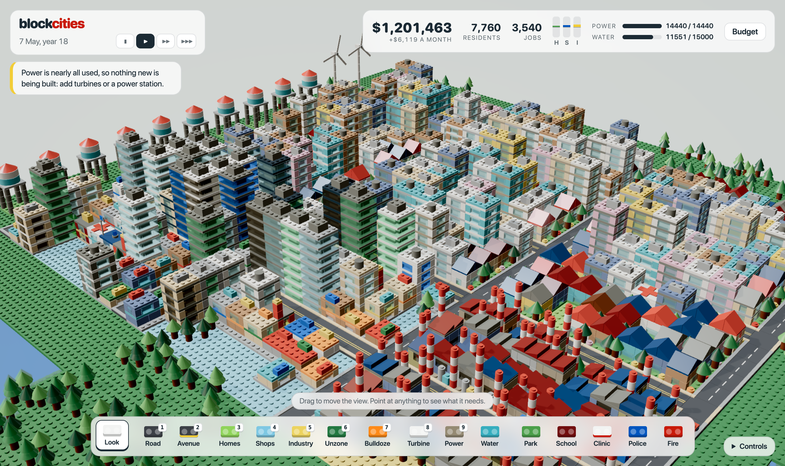
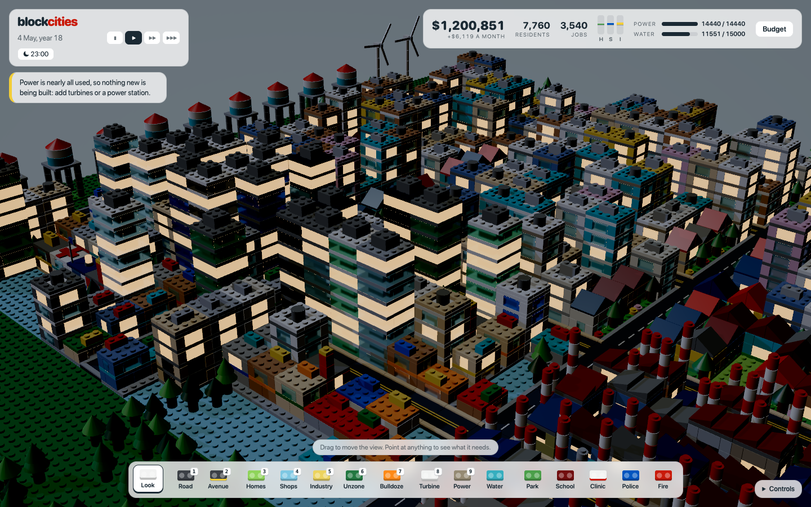

# Block Cities

A city builder where everything is made of studded toy bricks. Lay roads, zone
lots, supply power and water, and the city builds itself one brick at a time.



## Play

```sh
npm install
npm run dev
```

Open the address it prints in a WebGPU browser (Chrome, Edge, recent Safari).

1. **Road**: drag to lay it. Lots within two tiles of a road can be built on.
2. **Homes, Shops, Industry**: drag to zone lots. Zoning is free.
3. **Turbine** and **Water**: buildings go up without them, but stand empty
   under a flashing bolt or drop until they have both. An empty building pays
   no tax.
4. Buildings rise brick by brick while the three demand bars (H, S, I) are up.
5. **Park, School, Clinic, Police, Fire** raise land value around them; land
   value and the city's size decide how tall homes and shops grow, from
   cottages to glass towers. Industry and power stations pollute, which lowers it.
6. Every working resident drives to the nearest jobs each day. A road past half
   its capacity is noisy and lowers the land value of the homes along it.
   **Avenue** carries four times as much: drag it over a road to widen it, or
   put jobs nearer the homes.
7. **Budget** sets the tax rate: more income per resident and job, less demand.
   Services cost more to run as the city grows, so a big city has to choose.

The chat bubble at the bottom right is the city planner. It walks a new mayor
through seven steps, from the first road to making money, ticks each one off,
and then speaks up with suggestions as the city grows. Pointing at any tile
says what it is waiting for. The city is congratulated at 100, 500, 1,500,
4,000, 8,000 and 15,000 residents.

| Control | Does |
| --- | --- |
| `W` `A` `S` `D`, arrows, middle-drag, `Shift`-drag, or drag with **Look** | move |
| `Q` `E`, right-drag, or `Alt`/`Ctrl`/`Cmd`-drag | turn (drag up and down to tilt) |
| `R` `F` | tilt |
| wheel, `Z` `X` | zoom |
| `1`–`9` | tools, in toolbar order |
| `Esc` | abandon a drag, then put the tool down |
| `Space` | pause |

The sun goes round once every four minutes of play, and windows light up at
night. The clock button under the date turns that off and keeps it at noon.



The city saves itself to the browser every 15 game days and when the tab is hidden.

## What is and is not simulated

- Power and water are city-wide totals, not networks: supply reaches every
  building until it runs out. Buildings that already had it are served first,
  so a new building never takes the lights from one that is lived in.
- Traffic is a daily load on each road tile, from every home to its nearest
  jobs by the shortest way. It makes noise; it does not slow anyone down, and
  shops and industry do not mind it. The cars you see are for show: they drive
  real routes and keep to the right, but they are not that load.
- A finished building never shrinks because its land value fell, only when
  demand turns negative or it loses its road. Without power or water it
  empties but stays standing.
- There are no disasters, crime or fire events: police, fire stations, clinics
  and schools all act as land value.
- Night is lighting only: there are no street lamps or headlights, and nothing
  in the simulation knows what time it is.
- There is no sound, and no touch gestures beyond a one-finger drag.

## How it is put together

- `src/game/` is the whole simulation and has no rendering imports: the grid
  (`city.ts`), the map, the mayor's tools (`actions.ts`), what follows from what
  is built (`derive.ts`), the daily step (`sim.ts`), traffic, saving, and the
  brick-by-brick `blueprints.ts` of every building. `tuning.ts` holds the numbers.
- `src/world/` draws it: `brick-set.ts` draws every brick as an instance of one
  of four shapes plus studs; `city-view.ts` turns the grid into bricks.
- `src/render/` is the renderer from Jellyland (WebGPU setup, studio HDR
  lighting, bloom and grade), plus the plastic and glass materials. Glass bricks
  are the only transparent thing, using physical transmission.
- `src/app/` is input, the interface and the frame loop.

## Tuning the money without a screen

`sim/` plays whole games headlessly, at over a thousand times normal speed, to
check and tune the balance between what things cost and what the city earns.

```sh
npm run sim               # play the target games and print how the money went
npm run tune              # search for a better balance and print it
npm run tune -- --write   # ...and write it to src/game/balance.json
```

- `src/game/balance.json` holds every price, upkeep and tax yield. The game
  reads it; the tuner rewrites it.
- `sim/mayor.ts` is a mayor with no screen. It sees what a player sees and acts
  only through the same two functions as the mouse, so it cannot cheat. It
  comes in styles: *careful* reads the budget before building a service,
  *generous* does not and has to raise taxes and close things when the money
  runs out.
- `sim/targets.ts` says what a good balance looks like as bands: a careful
  mayor never in debt, a profit of 5 to 20 percent, no more than about a year
  of income in the bank after fifteen years; a generous one in debt for a
  while and able to climb out. Final population is also judged on the worst
  map, so one map going well cannot hide a city stuck on another.
  **These are design intent. Change them there.**
- `sim/tune.ts` turns six knobs (tax yield, service upkeep, service cost,
  roads, starting money, how fast staffing costs climb) to minimise the
  distance from those bands, playing every candidate in worker threads.

Three targets are watched but not tuned, because prices do not move them: how
soon a new city breaks even, and how fast it reaches 500 and 5,000 residents.
Those are set by the growth rates in `src/game/tuning.ts`.

## Checks

```sh
npm test    # simulation, blueprint, daylight and testbed invariants (node --test)
uv run --with playwright scripts/drive.py http://localhost:5173/ shots "new:7;run:scripts/demo-city.js;shot:city;snap"
```

The second command drives the running dev server in real Chrome, with the real
mouse and keyboard or through `window.__blockcities`, the automation hook that
goes through the same functions as the interface. See the docstring in
`scripts/drive.py` for the steps.

## Licence

GPL-3.0-only (see `LICENSE`), inherited from the renderer; `NOTICE.md` lists
which files are adapted and from where.
